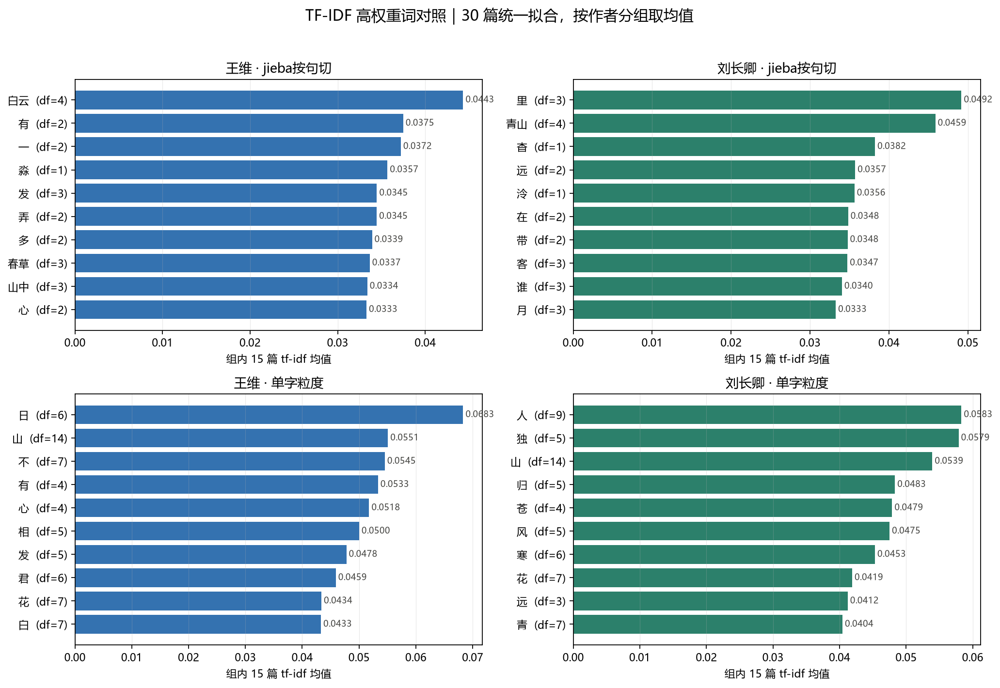
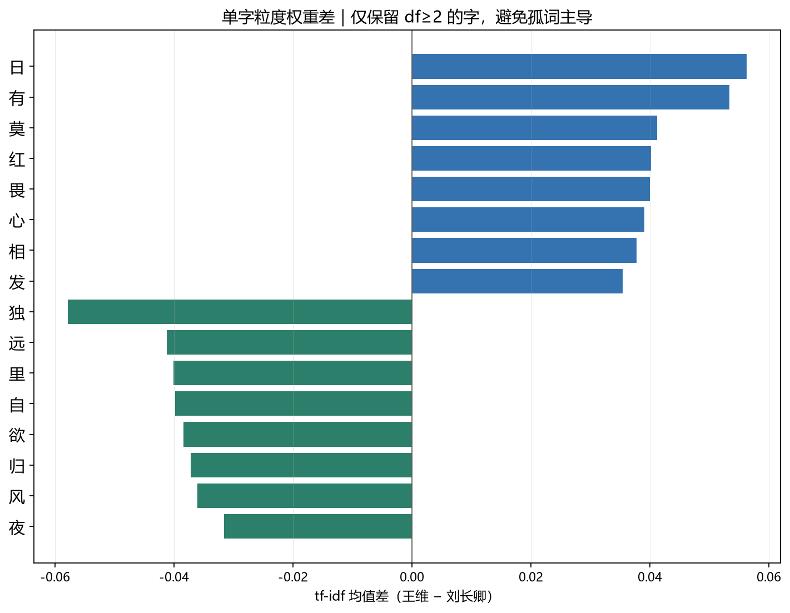

# 任务二：王维与刘长卿五言绝句的文本特征比较

> 方法与数据：Python 3 / `jieba` 0.42.1 / `scikit-learn` 1.9.1 / `zhconv` 1.4.3 / `matplotlib` 3.11.2
> 数据来源：[chinse-poetry · 全唐诗

---

## 一、语料与分词说明

### 1.1 语料来源与筛选

仓库「全唐诗」目录含 58 个 `poet.tang.<n>.json` 分片（每片 1000 首），字段为 `author / title / paragraphs / id`。**作者名与正文均为繁体**（`王維` / `劉長卿`），库中归属王维 403 首、刘长卿 531 首。

筛选规则（不作主题挑选，可完整复跑）：按标点切句后**恰好 4 句、每句 5 个汉字、正文共 20 字**；筛选出五言绝句王维 51 首、刘长卿 28 首。

在按原顺序排列的候选内**等距抽取 15 首**。

### 1.2 统一分词与停用词规则

TF-IDF 是**词袋模型**，丢弃语序、句法与语境；中文没有空格，若不先分词，`TfidfVectorizer` 默认会把整句 20 字当作一个 token，30 篇词表几乎不重叠，分析直接失效。两位作者必须**共用同一分词器、同一停用词表、同一个 Vectorizer 的一次拟合**，否则词表与 idf 尺度不同，两组权重不可比。

1. **繁→简统一**：分词前用 `zhconv.convert(x, 'zh-cn')` 转为简体，否则「爲/为」「煙/烟」会被当成两个词，凭空制造差异。
2. **双粒度并行**：`jieba` 词粒度（主）+ 单字粒度（稳健性对照）。jieba 是现代汉语词典，把整首 20 字连写喂入会产生跨句伪词，故**以五言句为硬边界、句内再分词**。
3. **停用词表**：共 18 个纯文言虚词（之、乎、者、也、而、以、于、其、所、则、乃、且、若、岂、哉、矣、焉、耳），按 token 精确匹配、两位作者共用、在繁→简之后应用。高频诊断显示本语料最高频的是「山、人、花、日、青、白」等**实义意象**，「不／无／莫／相／独／空／一／君／归」等虽偏功能但承载否定、孤独等风格信息，一律保留；不对 jieba 组合词（复为、不共、莫以）二次拆改，以免引入第二套规则。全语料实际仅命中 4 次（以 1、者 1、且 2），印证古诗几乎没有可删的现代虚词。

分词后规模：**词粒度 307 个 token（df≥2 仅 31 个），单字粒度 344 个字（df≥2 共 113 个）**。约九成词只出现一次。

---

## 二、分析设置与结果

### 2.1 设置

`tfidf(t,d) = tf(t,d) × idf(t)`，其中 sklearn 的 `idf = ln((1+n)/(1+df)) + 1`（n=30 篇，df 为包含该词的文档数）；随后对每篇做 **l2 归一化**，把向量长度缩为 1，消除篇幅影响——本语料每篇同为 20 字，该项对所有文档一视同仁。

| 参数 | 取值 | 理由 |
|---|---|---|
| `analyzer` | 空白切分（复用已分好的 token） | 分词规则由我们自己控制，不让默认 `token_pattern` 接管中文 |
| `use_idf / smooth_idf` | `True / True` | 启用 idf 及平滑 |
| `norm / sublinear_tf` | `'l2' / False` | sklearn 默认，保持与常见教程一致 |
| `min_df` | 主分析 `1`；敏感性 `2` | df=1 孤词 idf 最高，须单独检验 |
| 拟合方式 | **在全部 30 篇上 `fit_transform` 一次** | 词表与 idf 只有一套，再按作者分组各取 15 行均值 |
| 粒度 | `char` 为主结论，`word` 为辅助 | 见 2.3 敏感性 |

高权重 ≠ 词频，也不等于「某人的特色」。「山」df=14（近半数篇目都有）idf 被压到 1.7259，而「日」df=6、idf=2.4881 反而居王维首位；且「山、花、寒」两人共用，共同的高权重不产生差异。真正有区分力的是**两组均值之差**。

### 2.2 高权重词（单字粒度，各组前 15）

| 排名 | 王维 字 | tf-idf 组均值 | df(30篇) | 刘长卿 字 | tf-idf 组均值 | df(30篇) |
|---:|:---:|---:|---:|:---:|---:|---:|
| 1 | 日 | 0.068322 | 6 | 人 | 0.058315 | 9 |
| 2 | 山 | 0.055086 | 14 | 独 | 0.057891 | 5 |
| 3 | 不 | 0.054538 | 7 | 山 | 0.053942 | 14 |
| 4 | 有 | 0.053341 | 4 | 归 | 0.048322 | 5 |
| 5 | 心 | 0.051773 | 4 | 苍 | 0.047902 | 4 |
| 6 | 相 | 0.050017 | 5 | 风 | 0.047512 | 5 |
| 7 | 发 | 0.047775 | 5 | 寒 | 0.045320 | 6 |
| 8 | 君 | 0.045914 | 6 | 花 | 0.041897 | 7 |
| 9 | 花 | 0.043379 | 7 | 远 | 0.041228 | 3 |
| 10 | 白 | 0.043293 | 7 | 青 | 0.040444 | 7 |
| 11 | 莫 | 0.041191 | 3 | 里 | 0.040115 | 3 |
| 12 | 红 | 0.040155 | 3 | 门 | 0.039961 | 4 |
| 13 | 畏 | 0.039968 | 3 | 自 | 0.039788 | 3 |
| 14 | 草 | 0.039415 | 4 | 潮 | 0.039079 | 4 |
| 15 | 云 | 0.039402 | 4 | 欲 | 0.038460 | 3 |

词粒度结果（供对照）：王维 `白云 / 有 / 一 / 淼 / 发 / 弄 / 多 / 春草 / 山中 / 心`；刘长卿 `里 / 青山 / 杳 / 远 / 泠 / 在 / 带 / 客 / 谁 / 月`。

### 2.3 敏感性检验

把 `min_df` 从 1 改为 2 后：词表 word `307 → 31`、char `344 → 113`；**单字粒度两位作者 top10 各 10/10 全部存活**，词粒度 top10 中有 3 个（淼、杳、泠）被淘汰、9/10 与 8/10 保留。说明 jieba 粒度里 df=1 的孤字排名几乎全靠 idf 撑起，故**主结论以单字粒度为准、词粒度仅作辅助**。

### 2.4 对照图

**图 1｜TF-IDF 高权重词对照**（2×2：jieba 词粒度 / 单字粒度 × 两位作者，30 篇统一拟合后分组取均值）

**图 2｜单字粒度权重差**（仅保留 df≥2 的字，避免孤词主导；左侧为刘长卿侧、右侧为王维侧）

**图 3｜词云（辅助浏览）**

| 王维 | 刘长卿 |
|---|---|
|  |  |

> **图的使用限制**：词云按权重决定字号，却不显示 df，会把切分伪影放大成视觉焦点——王维词云中字号最大的「畏向阶」「心心视」「寒梅啼」其实都是 jieba 把「畏向階前生」「心心視春草」「已見寒梅發／復聞啼鳥聲」按现代词表硬切出的碎片。因此**词云只作辅助，带 df 标注的条形图才是证据**。

---

## 三、主题 / 关键词表

> ⚠️ **TF-IDF 不产出「主题」**。算法只给每个 token 一个权重；下表「主题」一列是研究者读完原句后的**人工二次归类**，属解释而非算法输出，故逐行附代表原句与归类依据，以便复核与质疑。差值为「王维均值 − 刘长卿均值」，正＝偏王维、负＝偏刘长卿；df 为全 30 篇中包含该字的篇数。完整 11 列见 `附件/主题关键词表.csv`。

| 主题（人工归类） | 字 | 权重倾向 | 差值(王−刘) | df | 代表原句（题名简体／正文保留繁体） | 核查状态 / 归类依据 |
|---|:---:|:---:|---:|---:|---|---|
| 人际/情感 | 独 | 刘长卿侧 | −0.057891 | 5 | 《赠秦系征君》五柳獨知貧 | 已抽查：「独知贫／独住／独挥手／独归远」皆表孤身，实义且集中，较可靠 |
| 人际/情感 | 畏 | 王维侧 | +0.039968 | 3 | 《辋川集 宫槐陌》畏有山僧來 | 未抽查，按字义人工归类 |
| 人际/情感 | 心 | 王维侧 | +0.039063 | 4 | 《荅裴迪辋口遇雨忆终南山之作》心知白雲外 | 未抽查，按字义人工归类 |
| 人际/情感 | 相 | 王维侧 | +0.037785 | 5 | 《赠韦穆十八》不相東山去 | 未抽查，按字义人工归类 |
| 人际/情感 | 人 | 刘长卿侧 | −0.029389 | 9 | 《逢雪宿芙蓉山主人》風雪夜歸人 | 已抽查：两人共用高频字，区分力低，不作任何一方特色 |
| 人际/情感 | 君 | 王维侧 | +0.023116 | 6 | 《辋川集 欹湖》日暮送夫君 | 未抽查，按字义人工归类 |
| 功能词/虚词 | 有 | 王维侧 | +0.053341 | 4 | 《辋川集 孟城坳》空悲昔人有 | 未抽查，按字义人工归类 |
| 功能词/虚词 | 莫 | 王维侧 | +0.041191 | 3 | 《息夫人》莫以今時寵 | 已抽查：三处全为否定祈使，属语法功能词，**不作主题证据** |
| 功能词/虚词 | 自 | 刘长卿侧 | −0.039788 | 3 | 《夜中对雪赠秦系…》君自憶山陰 | 未抽查，按字义人工归类 |
| 功能词/虚词 | 欲 | 刘长卿侧 | −0.038460 | 3 | 《斑竹》欲識湘妃怨 | 未抽查，按字义人工归类 |
| 功能词/虚词 | 不 | 王维侧 | +0.033984 | 7 | 《息夫人》不共楚王言 | 未抽查，按字义人工归类 |
| 山水/空间 | 远 | 刘长卿侧 | −0.041228 | 3 | 《逢雪宿芙蓉山主人》日暮蒼山遠 | 已抽查：「苍山远／独归远／今近远」表空间距离，实义 |
| 山水/空间 | 里 | 刘长卿侧 | −0.040115 | 3 | 《正朝览镜作》朝來明鏡裏 | 已抽查：**三处繁体均作「裏」**，简繁合并伪影，见第四节 |
| 山水/空间 | 云 | 王维侧 | +0.027546 | 4 | 《辋川集 欹湖》青山卷白雲 | 未抽查，按字义人工归类 |
| 山水/空间 | 门 | 刘长卿侧 | −0.027508 | 4 | 《逢雪宿芙蓉山主人》柴門聞犬吠 | 未抽查，按字义人工归类 |
| 山水/空间 | 潮 | 刘长卿侧 | −0.026000 | 4 | 《送张十八归桐庐》正落寒潮水 | 未抽查，按字义人工归类 |
| 山水/空间 | 山 | 共有/接近 | +0.001143 | 14 | 《辋川集 斤竹岭》暗入商山路 | 两人共用，差值近零，**不作差异证据** |
| 时间/天候 | 日 | 王维侧 | +0.056256 | 6 | 《息夫人》難忘舊日恩 | 已抽查：实义时间意象，但「旧日／日日／日暮／日令」词义不统一，不宜概括为「多写日光」 |
| 时间/天候 | 风 | 刘长卿侧 | −0.036057 | 5 | 《逢雪宿芙蓉山主人》風雪夜歸人 | 未抽查，按字义人工归类 |
| 时间/天候 | 寒 | 刘长卿侧 | −0.023648 | 6 | 《逢雪宿芙蓉山主人》天寒白屋貧 | 已抽查：两人都用（寒流／寒梅 vs 天寒／松风寒／寒潮），**共享词，不作差异证据** |
| 色彩/视觉 | 红 | 王维侧 | +0.040155 | 3 | 《辋川集 辛夷坞》山中發紅萼 | 已抽查：「红萼／红莲衣／红豆」均为色彩修饰，王维侧较可靠 |
| 色彩/视觉 | 苍 | 刘长卿侧 | −0.024061 | 4 | 《逢雪宿芙蓉山主人》日暮蒼山遠 | 未抽查，按字义人工归类 |
| 色彩/视觉 | 白 | 王维侧 | +0.011322 | 7 | 《辋川集 欹湖》青山卷白雲 | 已抽查：多为「白云／白石」色彩物象；刘长卿侧「白屋／白头」并非颜色描写 |
| 色彩/视觉 | 青 | 刘长卿侧 | −0.007096 | 7 | 《赠秦系征君》惆悵青山路 | 未抽查，按字义人工归类 |
| 草木/物候 | 发 | 王维侧 | +0.035454 | 5 | 《辋川集 辛夷坞》山中發紅萼 | 未抽查，按字义人工归类 |
| 草木/物候 | 草 | 王维侧 | +0.026244 | 4 | 《赠韦穆十八》日令春草深 | 未抽查，按字义人工归类 |
| 草木/物候 | 花 | 共有/接近 | +0.001482 | 7 | 《息夫人》看花滿眼淚 | 两人共用，**不作差异证据** |
| 行旅/归程 | 归 | 刘长卿侧 | −0.037185 | 5 | 《逢雪宿芙蓉山主人》風雪夜歸人 | 已抽查：王维仅 1 篇（暮归）、刘长卿 4 篇，方向性差异相对可靠 |

**归纳（只到样本层面）**：本样本中偏王维的是「红、白、君、日、发」等色彩与物候字，偏刘长卿的是「独、归、远、苍、风」等孤身与行旅字；「山、花、寒、人、青、白」为两人共享，不构成差异。此归纳与文学史常识「盛唐闲适 vs 大历清空」**相容，但不等于证明**。

---

## 四、原文语境抽查记录

词袋模型最大的代价是丢掉语境：它只知道「独」出现过，不知道是「独住青山客」的独居还是别的用法。故按 **A 稳健词 / B df=1 孤词 / C 预处理与切分伪影** 三层抽查，共 **15 个词、55 条原句**，逐条附繁体原句、简体对译、篇题与句位（完整表见 `附件/抽查记录.csv`）。下表为每词的代表原句与结论。

### A 稳健词（df≥2，9 词）

| 词 | df | 命中句 | 代表原句（繁 → 简） | 核查结论 | 处置 |
|:---:|---:|---:|---|---|---|
| 日 | 6 | 6 | 《息夫人》難忘舊日恩 → 难忘旧日恩 | 实义时间/天色意象，但「旧日／日日／日暮／日令」词义不统一 | 保留，不作「多写日光」的概括 |
| 白 | 7 | 7 | 《辋川集 欹湖》青山卷白雲 → 青山卷白云 | 多为「白云／白石」色彩物象；刘长卿侧「白屋／白头」非颜色描写 | 保留 |
| 红 | 3 | 3 | 《辋川集 辛夷坞》山中發紅萼 → 山中发红萼 | 「红萼／红莲衣／红豆」均为色彩修饰，实义 | 保留，王维侧较可靠 |
| 莫 | 3 | 3 | 《息夫人》莫以今時寵 → 莫以今时宠 | 三处全为否定祈使（莫以／莫溅水／莫待），语法功能词 | **剔除**，不作意象证据 |
| 独 | 5 | 5 | 《赠秦系征君》五柳獨知貧 → 五柳独知贫 | 「独知贫／独住／独挥手／独归远」皆表孤身，实义且集中 | 保留，刘长卿侧较可靠 |
| 归 | 5 | 5 | 《逢雪宿芙蓉山主人》風雪夜歸人 → 风雪夜归人 | 实义归程；王维仅 1 篇、刘长卿 4 篇 | 保留，方向性差异相对可靠 |
| 寒 | 6 | 6 | 《杂诗三首 三》已見寒梅發 → 已见寒梅发 | 两人均用（寒流／寒梅 vs 天寒／松风寒／寒潮／寒塘） | **剔除**，共享词 |
| 远 | 3 | 3 | 《送灵澈上人》青山獨歸遠 → 青山独归远 | 「苍山远／独归远／今近远」表空间距离，实义 | 保留 |
| 人 | 9 | 9 | 《逢雪宿芙蓉山主人》風雪夜歸人 → 风雪夜归人 | 两人共用高频字，df=9，区分力低 | **剔除**，不作任一方特色 |

### B 孤词（df=1，3 词）

| 词 | 代表原句 | 核查结论 | 处置 |
|:---:|---|---|---|
| 淼 | 《荅裴迪辋口遇雨忆终南山之作》淼淼寒流廣 | 「淼淼」叠词首字被切出，仅 1 篇，权重几乎全由 idf 抬高 | **剔除** |
| 杳 | 《送灵澈上人》杳杳鐘聲晚 → 杳杳钟声晚 | 「杳杳」叠词首字，仅 1 篇，同上 | **剔除** |
| 泠 | 《听弹琴》泠泠七絲上 → 泠泠七丝上 | 「泠泠」叠词首字，仅 1 篇，同上 | **剔除** |

### C 预处理 / 切分伪影（4 词）

| 词 | 代表原句 | 核查结论 | 处置 |
|:---:|---|---|---|
| 里 | 《正朝览镜作》朝來明鏡裏 → 朝来明镜里；《入百丈涧见桃花晚开》百丈深澗裏 → 百丈深涧里 | 刘长卿 **jieba 粒度权重第 1 名**，但三处原文都作「裏」（明鏡裏／深澗裏／白雲裏），是方位词；繁→简把「裏」并入「里」 | **降级**：该第一名含预处理伪影，不能当风格证据 |
| 畏向阶 | 《杂诗三首 三》畏向階前生 → 畏向阶前生 | 原句被切成「畏向阶／前生」，不是汉语词 | **剔除** |
| 心心视 | 《杂诗三首 三》心心視春草 → 心心视春草 | 原句被切成「心心视／春草」，不是汉语词 | **剔除** |

---

## 五、解释

> 结果只支持一点：这 30 篇五绝里，单字 tf-idf 组均值有差异，王维侧「红、白、君」、刘长卿侧「独、归、远」偏前，回查多为实义意象，可称本样本用词倾向，可能属于山水诗共有的特点。虽然用词偏好有所不同，但考虑到风格均与自然相关，主题词也多与山水风景有关，难以证明作者风格或文风之别。

---